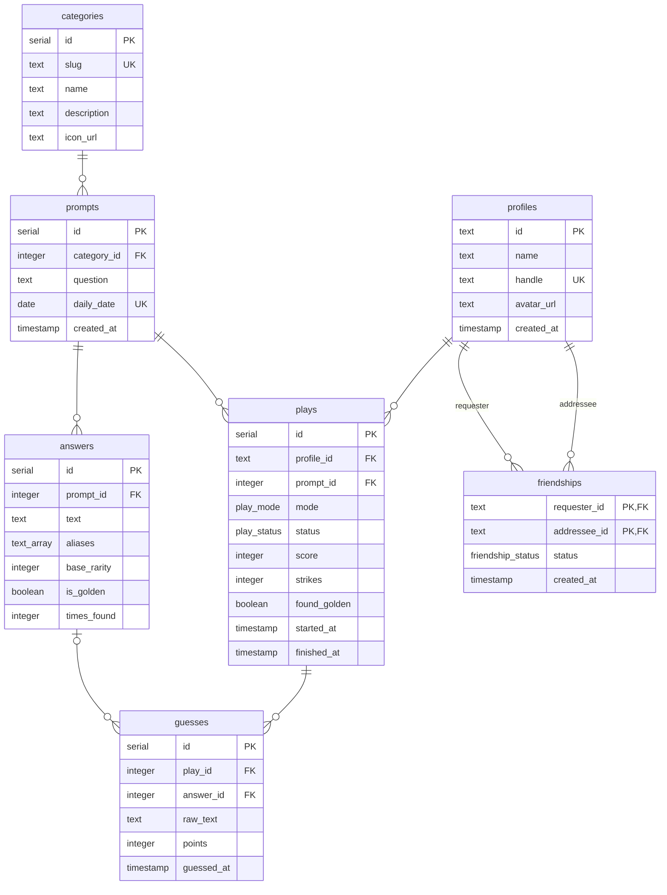

# Tarillion: Database Schema and API Documentation

COMP 426 Final Project, Fall 2026

Team: Maxwell Hu, Yewon Song, Ethan Tran, Aiden Li

The database is Supabase Postgres, defined with Drizzle in `server/db/schema.ts`. The API uses tRPC. Each procedure is available at `/api/trpc/<router>.<procedure>`, and its input and output are checked by the Zod models in `server/models/`.

## 1. Database Schema



Relationships:

- Many-to-one: prompts to categories, answers to prompts, plays to profiles, plays to prompts, guesses to plays, guesses to answers.
- Many-to-many: profiles and prompts through plays, profiles and profiles through friendships, plays and answers through guesses.

Enums:

- play_mode: daily, unlimited
- play_status: in_progress, finished
- friendship_status: pending, accepted

### profiles

| Column | Type | Notes |
| --- | --- | --- |
| id | text | PK, the Supabase auth user id |
| name | text | not null |
| handle | text | not null, unique |
| avatar_url | text | nullable, path in the avatars bucket |
| created_at | timestamp | default now() |

### categories

| Column | Type | Notes |
| --- | --- | --- |
| id | serial | PK |
| slug | text | not null, unique |
| name | text | not null |
| description | text | nullable |
| icon_url | text | nullable, path in the category-icons bucket |

### prompts

| Column | Type | Notes |
| --- | --- | --- |
| id | serial | PK |
| category_id | integer | FK to categories.id |
| question | text | not null |
| daily_date | date | nullable, unique; the day this is the daily prompt |
| created_at | timestamp | default now() |

### answers

| Column | Type | Notes |
| --- | --- | --- |
| id | serial | PK |
| prompt_id | integer | FK to prompts.id, cascade delete |
| text | text | not null |
| aliases | text[] | other accepted spellings |
| base_rarity | integer | default 50; used until a prompt has 20 finished plays |
| is_golden | boolean | default false; the Golden Ram |
| times_found | integer | default 0 |

### plays

| Column | Type | Notes |
| --- | --- | --- |
| id | serial | PK |
| profile_id | text | FK to profiles.id, cascade delete |
| prompt_id | integer | FK to prompts.id, cascade delete |
| mode | play_mode | not null |
| status | play_status | default in_progress |
| score | integer | default 0 |
| strikes | integer | default 0; round ends at 3 |
| found_golden | boolean | default false |
| started_at | timestamp | default now() |
| finished_at | timestamp | nullable |

Unique index on (profile_id, prompt_id) where mode = 'daily', so one daily attempt per user.

### guesses

| Column | Type | Notes |
| --- | --- | --- |
| id | serial | PK |
| play_id | integer | FK to plays.id, cascade delete |
| answer_id | integer | FK to answers.id, nullable; null means wrong guess |
| raw_text | text | not null |
| points | integer | default 0 |
| guessed_at | timestamp | default now() |

### friendships

| Column | Type | Notes |
| --- | --- | --- |
| requester_id | text | PK, FK to profiles.id |
| addressee_id | text | PK, FK to profiles.id |
| status | friendship_status | default pending |
| created_at | timestamp | default now() |

Storage buckets: avatars (profile pictures), category-icons (category images).

## 2. API

Public procedures work without logging in. Auth procedures need a Supabase session and return UNAUTHORIZED otherwise.

### Output types

```ts
type Profile = { id: string; name: string; handle: string; avatarUrl: string | null; createdAt: Date };

type Category = { id: number; slug: string; name: string; description: string | null; iconUrl: string | null };

// Never includes answers.
type Prompt = { id: number; question: string; category: Category; dailyDate: string | null; answerCount: number };

type Guess = { id: number; rawText: string; matchedAnswer: string | null; points: number; isGolden: boolean; guessedAt: Date };

type Play = {
  id: number; prompt: Prompt; mode: "daily" | "unlimited"; status: "in_progress" | "finished";
  score: number; strikes: number; maxStrikes: number; foundGolden: boolean;
  startedAt: Date; finishedAt: Date | null; guesses: Guess[];
};

type RevealedAnswer = { id: number; text: string; rarity: number; foundRate: number; isGolden: boolean; foundByMe: boolean };

type LeaderboardEntry = { rank: number; profile: Profile; score: number; foundGolden: boolean };

type Stats = {
  gamesPlayed: number; dailyGamesPlayed: number; currentDailyStreak: number; longestDailyStreak: number;
  bestScore: number; averageScore: number; answersFound: number; goldenRamsFound: number;
};

type PlaySummary = { id: number; promptId: number; question: string; mode: "daily" | "unlimited"; score: number; foundGolden: boolean; finishedAt: Date | null };

type Friend = { profile: Profile; status: "pending" | "accepted"; direction: "outgoing" | "incoming"; since: Date };

type Paginated<T> = { items: T[]; nextCursor: number | null };
```

### Scoring

- Guesses are compared to each answer's text and aliases, ignoring case and punctuation.
- Correct: points = rarity = 100 x (1 - times_found / finished plays), between 5 and 100. Uses base_rarity until the prompt has 20 finished plays.
- Golden Ram: 250 bonus points.
- Repeat of an answer already found: no points, no strike.
- Wrong: one strike. Three strikes finishes the play.

### profiles

| Procedure | Type | Access | Input | Output |
| --- | --- | --- | --- | --- |
| getAuthedUserProfile | query | Auth | none | Profile |
| getProfile | query | Public | { profileId: string } | Profile |
| getProfileByHandle | query | Public | { handle: string } | Profile |
| handleNewUser | mutation | Auth | { name: string; handle: string } | void |
| updateProfile | mutation | Auth | { name?: string; handle?: string } | Profile |
| updateAvatar | mutation | Auth | { avatarUrl: string \| null } | void |
| searchProfiles | query | Auth | { query: string } | Profile[] |

handleNewUser creates the profile after sign-up. The handle must be 3 to 20 lowercase letters, numbers, or underscores, and returns CONFLICT if taken.

### categories

| Procedure | Type | Access | Input | Output |
| --- | --- | --- | --- | --- |
| getCategories | query | Public | none | Category[] |

### prompts

| Procedure | Type | Access | Input | Output |
| --- | --- | --- | --- | --- |
| getDailyPrompt | query | Public | none | Prompt |
| getPrompt | query | Public | { promptId: number } | Prompt |
| getRandomPrompt | query | Public | { categorySlug?: string } | Prompt |
| getArchive | query | Public | { cursor?: number; limit?: number; categorySlug?: string } | Paginated\<Prompt\> |

getArchive returns past daily prompts, newest first.

### game

| Procedure | Type | Access | Input | Output |
| --- | --- | --- | --- | --- |
| startPlay | mutation | Auth | { promptId: number; mode: "daily" \| "unlimited" } | Play |
| getPlay | query | Auth | { playId: number } | Play |
| getMyDailyPlay | query | Auth | { promptId: number } | Play \| null |
| submitGuess | mutation | Auth | { playId: number; text: string } | { result: "correct" \| "duplicate" \| "wrong"; guess: Guess \| null; play: Play } |
| endPlay | mutation | Auth | { playId: number } | Play |
| revealAnswers | query | Auth | { promptId: number } | RevealedAnswer[] |

- startPlay resumes the user's existing daily play if there is one.
- revealAnswers is only allowed after the user has finished the prompt.

Example, submitGuess:

```json
// input
{ "playId": 918, "text": "carmichael" }

// output (play shortened)
{
  "result": "correct",
  "guess": { "id": 5521, "rawText": "carmichael", "matchedAnswer": "Carmichael", "points": 87, "isGolden": false, "guessedAt": "2026-12-01T15:04:11.000Z" },
  "play": { "id": 918, "status": "in_progress", "score": 143, "strikes": 1, "maxStrikes": 3, "foundGolden": false, "guesses": [] }
}
```

### leaderboard

| Procedure | Type | Access | Input | Output |
| --- | --- | --- | --- | --- |
| getDailyLeaderboard | query | Public | { date?: string; limit?: number } | LeaderboardEntry[] |
| getAllTimeLeaderboard | query | Public | { limit?: number } | LeaderboardEntry[] |
| getFriendsLeaderboard | query | Auth | { date?: string; limit?: number } | LeaderboardEntry[] |

date is YYYY-MM-DD and defaults to today.

### friends

| Procedure | Type | Access | Input | Output |
| --- | --- | --- | --- | --- |
| getFriends | query | Auth | none | Friend[] |
| getPendingRequests | query | Auth | none | Friend[] |
| sendRequest | mutation | Auth | { handle: string } | Friend |
| respondToRequest | mutation | Auth | { requesterId: string; accept: boolean } | void |
| removeFriend | mutation | Auth | { profileId: string } | void |

### stats

| Procedure | Type | Access | Input | Output |
| --- | --- | --- | --- | --- |
| getMyStats | query | Auth | none | Stats |
| getProfileStats | query | Public | { profileId: string } | Stats |
| getMyHistory | query | Auth | { cursor?: number; limit?: number } | Paginated\<PlaySummary\> |
