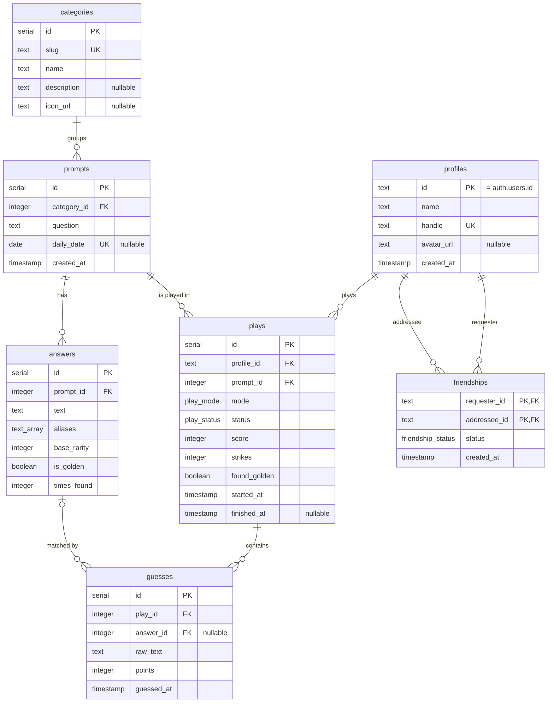

# Tarillion: Database Schema & API Documentation

**COMP 426 Final Project, Fall 2026**

**Team:** Maxwell Hu, Yewon Song, Ethan Tran, Aiden Li

**Repository:** https://github.com/maxwellhu9/tarillion

The database is Supabase Postgres, defined with Drizzle ORM in [`server/db/schema.ts`](../server/db/schema.ts). The API is built with **tRPC**: every procedure is served from `/api/trpc/<router>.<procedure>` and called from the front end asynchronously through `@trpc/react-query` hooks. Input and output shapes are enforced by the Zod models in [`server/models/inputs.ts`](../server/models/inputs.ts) and [`server/models/responses.ts`](../server/models/responses.ts).

---

## 1. Database Schema

### Diagram



### Relationships

| Type | Relationship | Through |
| --- | --- | --- |
| Many-to-one | `prompts.category_id → categories.id` | |
| Many-to-one | `answers.prompt_id → prompts.id` | |
| Many-to-one | `plays.profile_id → profiles.id`, `plays.prompt_id → prompts.id` | |
| Many-to-one | `guesses.play_id → plays.id`, `guesses.answer_id → answers.id` | |
| **Many-to-many** | profiles ↔ prompts (which users played which prompts) | `plays` |
| **Many-to-many** | profiles ↔ profiles (friends) | `friendships` |
| **Many-to-many** | plays ↔ answers (which answers each play found) | `guesses` |

### Enums

| Enum | Values |
| --- | --- |
| `play_mode` | `daily`, `unlimited` |
| `play_status` | `in_progress`, `finished` |
| `friendship_status` | `pending`, `accepted` |

### Tables

#### `profiles`: one per registered user
| Column | Type | Constraints |
| --- | --- | --- |
| `id` | `text` | **PK**, equals Supabase `auth.users.id` |
| `name` | `text` | not null |
| `handle` | `text` | not null, **unique** |
| `avatar_url` | `text` | nullable, path in the `avatars` storage bucket |
| `created_at` | `timestamp` | not null, default `now()` |

#### `categories`: topic groups for prompts
| Column | Type | Constraints |
| --- | --- | --- |
| `id` | `serial` | **PK** |
| `slug` | `text` | not null, **unique** (e.g. `campus`, `sports`) |
| `name` | `text` | not null |
| `description` | `text` | nullable |
| `icon_url` | `text` | nullable, path in the `category-icons` storage bucket |

#### `prompts`: a question, e.g. "Name a UNC residence hall"
| Column | Type | Constraints |
| --- | --- | --- |
| `id` | `serial` | **PK** |
| `category_id` | `integer` | not null, **FK → `categories.id`** (on delete restrict) |
| `question` | `text` | not null |
| `daily_date` | `date` | nullable, **unique**; set if this prompt is the Daily Heel for that date |
| `created_at` | `timestamp` | not null, default `now()` |

#### `answers`: accepted answers for a prompt
| Column | Type | Constraints |
| --- | --- | --- |
| `id` | `serial` | **PK** |
| `prompt_id` | `integer` | not null, **FK → `prompts.id`** (on delete cascade) |
| `text` | `text` | not null, canonical display text |
| `aliases` | `text[]` | not null, default `{}`; alternate spellings accepted by the matcher |
| `base_rarity` | `integer` | not null, default 50; seeded rarity used until enough plays exist |
| `is_golden` | `boolean` | not null, default false; marks the Golden Ram (at most one per prompt) |
| `times_found` | `integer` | not null, default 0; incremented whenever a play finds this answer |

#### `plays`: one user's attempt at one prompt (junction: profiles ↔ prompts)
| Column | Type | Constraints |
| --- | --- | --- |
| `id` | `serial` | **PK** |
| `profile_id` | `text` | not null, **FK → `profiles.id`** (on delete cascade) |
| `prompt_id` | `integer` | not null, **FK → `prompts.id`** (on delete cascade) |
| `mode` | `play_mode` | not null |
| `status` | `play_status` | not null, default `in_progress` |
| `score` | `integer` | not null, default 0 |
| `strikes` | `integer` | not null, default 0 (the round ends at 3) |
| `found_golden` | `boolean` | not null, default false |
| `started_at` | `timestamp` | not null, default `now()` |
| `finished_at` | `timestamp` | nullable |

Index: **unique** `(profile_id, prompt_id) WHERE mode = 'daily'`, so each user gets one daily attempt per prompt.

#### `guesses`: each submission in a play (junction: plays ↔ answers)
| Column | Type | Constraints |
| --- | --- | --- |
| `id` | `serial` | **PK** |
| `play_id` | `integer` | not null, **FK → `plays.id`** (on delete cascade) |
| `answer_id` | `integer` | nullable, **FK → `answers.id`** (on delete set null); null means a wrong guess (strike) |
| `raw_text` | `text` | not null, exactly what the user typed |
| `points` | `integer` | not null, default 0; points awarded at the time of the guess |
| `guessed_at` | `timestamp` | not null, default `now()` |

#### `friendships`: friend requests (junction: profiles ↔ profiles)
| Column | Type | Constraints |
| --- | --- | --- |
| `requester_id` | `text` | **PK (composite)**, **FK → `profiles.id`** (on delete cascade) |
| `addressee_id` | `text` | **PK (composite)**, **FK → `profiles.id`** (on delete cascade) |
| `status` | `friendship_status` | not null, default `pending` |
| `created_at` | `timestamp` | not null, default `now()` |

### Storage buckets (Supabase Storage)
| Bucket | Contents | Referenced by |
| --- | --- | --- |
| `avatars` | profile pictures, stored at `<profile id>` | `profiles.avatar_url` |
| `category-icons` | category artwork | `categories.icon_url` |

---

## 2. API (tRPC)

### Conventions
- **Transport:** tRPC over HTTP at `/api/trpc`. Queries are `GET`, mutations are `POST`. Payloads are serialized with **superjson**, so fields typed `Date` below arrive as real `Date` objects (ISO strings on the wire).
- **Auth:**
  - **Public** procedures work without logging in.
  - **Auth** procedures need a Supabase session cookie and otherwise throw `UNAUTHORIZED` (HTTP 401). The signed-in user is available on the server as `ctx.subject.id`.
- **Errors:** `NOT_FOUND` (404), `BAD_REQUEST` (400, including Zod validation errors in `error.data.zodError`), `FORBIDDEN` (403), `CONFLICT` (409).
- **Dates:** "today" for the Daily Heel is the current date in `America/New_York`.

### Shared output types

```ts
type Profile = {
  id: string;
  name: string;
  handle: string;
  avatarUrl: string | null;   // path in the "avatars" bucket
  createdAt: Date;
};

type Category = {
  id: number;
  slug: string;               // "campus", "sports", "dining", ...
  name: string;
  description: string | null;
  iconUrl: string | null;     // path in the "category-icons" bucket
};

// A prompt NEVER includes its answers.
type Prompt = {
  id: number;
  question: string;           // "Name a UNC residence hall"
  category: Category;
  dailyDate: string | null;   // "2026-12-01", or null for Unlimited-only prompts
  answerCount: number;        // how many valid answers exist
};

type Guess = {
  id: number;
  rawText: string;
  matchedAnswer: string | null;  // canonical answer text, or null if wrong
  points: number;
  isGolden: boolean;
  guessedAt: Date;
};

type Play = {
  id: number;
  prompt: Prompt;
  mode: "daily" | "unlimited";
  status: "in_progress" | "finished";
  score: number;
  strikes: number;
  maxStrikes: number;         // 3
  foundGolden: boolean;
  startedAt: Date;
  finishedAt: Date | null;
  guesses: Guess[];           // oldest first
};

type RevealedAnswer = {
  id: number;
  text: string;
  rarity: number;             // 5–100, higher = rarer
  foundRate: number;          // 0–1, share of finished plays that found it
  isGolden: boolean;
  foundByMe: boolean;
};

type LeaderboardEntry = {
  rank: number;
  profile: Profile;
  score: number;
  foundGolden: boolean;
};

type Stats = {
  gamesPlayed: number;
  dailyGamesPlayed: number;
  currentDailyStreak: number;
  longestDailyStreak: number;
  bestScore: number;
  averageScore: number;
  answersFound: number;
  goldenRamsFound: number;
};

type PlaySummary = {
  id: number;
  promptId: number;
  question: string;
  mode: "daily" | "unlimited";
  score: number;
  foundGolden: boolean;
  finishedAt: Date | null;
};

type Friend = {
  profile: Profile;
  status: "pending" | "accepted";
  direction: "outgoing" | "incoming";  // who sent the request
  since: Date;
};

type Paginated<T> = { items: T[]; nextCursor: number | null };
```

### Scoring rules (server-side, used by `game.submitGuess`)
- A guess is normalized (lower-cased, punctuation and "hall/library/the" noise words removed) and compared with each answer's `text` and `aliases`, allowing small typos (Levenshtein distance ≤ 2 for longer words).
- **Correct:** `points = rarity`, where `rarity = clamp(round(100 × (1 − times_found / finished_plays)), 5, 100)`. Before a prompt has 20 finished plays, `base_rarity` is used instead.
- **Golden Ram:** +250 on top of its rarity points.
- **Duplicate** (an answer already found in this play): no points, no strike.
- **Wrong:** +1 strike. At 3 strikes the play is set to `finished`.

---

### `profiles`

| Procedure | Type | Access | Input | Output |
| --- | --- | --- | --- | --- |
| `profiles.getAuthedUserProfile` | query | **Auth** | none | `Profile` |
| `profiles.getProfile` | query | Public | `{ profileId: string }` | `Profile` |
| `profiles.getProfileByHandle` | query | Public | `{ handle: string }` | `Profile` |
| `profiles.handleNewUser` | mutation | **Auth** | `{ name: string; handle: string }` | `void` |
| `profiles.updateProfile` | mutation | **Auth** | `{ name?: string; handle?: string }` | `Profile` |
| `profiles.updateAvatar` | mutation | **Auth** | `{ avatarUrl: string \| null }` | `void` |
| `profiles.searchProfiles` | query | **Auth** | `{ query: string }` | `Profile[]` |

- `getAuthedUserProfile` returns the profile of the signed-in user (used by the header). `NOT_FOUND` if the profile row has not been created yet.
- `getProfile` / `getProfileByHandle` return a public profile page. `NOT_FOUND` if no match.
- `handleNewUser` is called once right after Supabase sign-up to create the `profiles` row. `handle` must be 3–20 characters of `[a-z0-9_]`; `name` 1–50 characters. `CONFLICT` if the handle is taken.
- `updateProfile` changes the display name and/or handle, with the same validation and `CONFLICT` rule as above.
- `updateAvatar`: the client uploads the image to the `avatars` bucket first, then sends the stored path here (or `null` to remove it).
- `searchProfiles` searches handles and names by prefix (case-insensitive, up to 10 results, excluding the caller). Used to find friends.

Example: `profiles.handleNewUser`
```json
// input
{ "name": "Rameses", "handle": "rameses_fan" }
```

### `categories`

| Procedure | Type | Access | Input | Output |
| --- | --- | --- | --- | --- |
| `categories.getCategories` | query | Public | none | `Category[]` |

Returns every category in alphabetical order (used by the Unlimited mode picker and the archive filter).

### `prompts`

| Procedure | Type | Access | Input | Output |
| --- | --- | --- | --- | --- |
| `prompts.getDailyPrompt` | query | Public | none | `Prompt` |
| `prompts.getPrompt` | query | Public | `{ promptId: number }` | `Prompt` |
| `prompts.getRandomPrompt` | query | Public | `{ categorySlug?: string }` | `Prompt` |
| `prompts.getArchive` | query | Public | `{ cursor?: number = 0; limit?: number = 20; categorySlug?: string }` | `Paginated<Prompt>` |

- `getDailyPrompt` returns the prompt whose `daily_date` is today. `NOT_FOUND` if none is scheduled.
- `getPrompt` returns one prompt by id. Future daily prompts are hidden (`NOT_FOUND`).
- `getRandomPrompt` returns a random prompt with no `daily_date`, optionally in one category.
- `getArchive` returns past daily prompts, newest first, with today and future dates excluded. Pass `nextCursor` as `cursor` to load the next page.

Example: `prompts.getDailyPrompt` output
```json
{
  "id": 42,
  "question": "Name a UNC residence hall",
  "category": { "id": 1, "slug": "campus", "name": "Campus", "description": "Buildings, quads and landmarks", "iconUrl": "campus.png" },
  "dailyDate": "2026-12-01",
  "answerCount": 32
}
```

### `game`

| Procedure | Type | Access | Input | Output |
| --- | --- | --- | --- | --- |
| `game.startPlay` | mutation | **Auth** | `{ promptId: number; mode: "daily" \| "unlimited" }` | `Play` |
| `game.getPlay` | query | **Auth** | `{ playId: number }` | `Play` |
| `game.getMyDailyPlay` | query | **Auth** | `{ promptId: number }` | `Play \| null` |
| `game.submitGuess` | mutation | **Auth** | `{ playId: number; text: string }` | `{ result: "correct" \| "duplicate" \| "wrong"; guess: Guess \| null; play: Play }` |
| `game.endPlay` | mutation | **Auth** | `{ playId: number }` | `Play` |
| `game.revealAnswers` | query | **Auth** | `{ promptId: number }` | `RevealedAnswer[]` |

- `startPlay` creates a new play, or returns the caller's existing play when one already exists for that prompt in `daily` mode (or an `in_progress` one in `unlimited` mode). `BAD_REQUEST` if `mode` is `daily` and the prompt is not today's Daily Heel.
- `getPlay` returns one play with all of its guesses. `FORBIDDEN` if the play belongs to someone else.
- `getMyDailyPlay` returns the caller's daily play for the prompt, or `null` if they have not started it. Used on page load to resume or show results.
- `submitGuess` scores one guess (see Scoring rules). It inserts a `guesses` row, updates `plays.score / strikes / found_golden / status`, and increments `answers.times_found` on a first find. `BAD_REQUEST` if the play is already finished. `guess` is `null` for a duplicate.
- `endPlay` lets the player quit early and marks the play `finished`.
- `revealAnswers` returns every answer with live rarity, sorted rarest first, plus whether the caller found each one. `FORBIDDEN` unless the caller has a finished play for this prompt (for a past daily prompt, any signed-in user may view it).

Example: `game.submitGuess`
```json
// input
{ "playId": 918, "text": "carmichael" }

// output
{
  "result": "correct",
  "guess": {
    "id": 5521, "rawText": "carmichael", "matchedAnswer": "Carmichael Residence Hall",
    "points": 87, "isGolden": false, "guessedAt": "2026-12-01T15:04:11.000Z"
  },
  "play": {
    "id": 918, "mode": "daily", "status": "in_progress",
    "score": 143, "strikes": 1, "maxStrikes": 3, "foundGolden": false,
    "startedAt": "2026-12-01T15:02:40.000Z", "finishedAt": null,
    "prompt": { "id": 42, "question": "Name a UNC residence hall", "...": "..." },
    "guesses": [ "...all guesses so far..." ]
  }
}
```

### `leaderboard`

| Procedure | Type | Access | Input | Output |
| --- | --- | --- | --- | --- |
| `leaderboard.getDailyLeaderboard` | query | Public | `{ date?: "YYYY-MM-DD"; limit?: number = 25 }` | `LeaderboardEntry[]` |
| `leaderboard.getAllTimeLeaderboard` | query | Public | `{ limit?: number = 25 }` | `LeaderboardEntry[]` |
| `leaderboard.getFriendsLeaderboard` | query | **Auth** | `{ date?: "YYYY-MM-DD"; limit?: number = 25 }` | `LeaderboardEntry[]` |

- `getDailyLeaderboard` ranks finished `daily` plays for that date's prompt (default today) by score. Ties are broken by earlier `finished_at`.
- `getAllTimeLeaderboard` ranks players by the sum of all their daily scores; `foundGolden` is true if they have ever found a Golden Ram.
- `getFriendsLeaderboard` works like the daily board but only includes the caller and their accepted friends.

### `friends`

| Procedure | Type | Access | Input | Output |
| --- | --- | --- | --- | --- |
| `friends.getFriends` | query | **Auth** | none | `Friend[]` (status `accepted`) |
| `friends.getPendingRequests` | query | **Auth** | none | `Friend[]` (status `pending`, both directions) |
| `friends.sendRequest` | mutation | **Auth** | `{ handle: string }` | `Friend` |
| `friends.respondToRequest` | mutation | **Auth** | `{ requesterId: string; accept: boolean }` | `void` |
| `friends.removeFriend` | mutation | **Auth** | `{ profileId: string }` | `void` |

- `sendRequest` creates a pending `friendships` row from the caller to the user with that handle. If the other user had already sent the caller a request, it is accepted instead. `NOT_FOUND` for an unknown handle, `BAD_REQUEST` when sending a request to yourself, `CONFLICT` if the request already exists.
- `respondToRequest` accepts (sets the status to `accepted`) or declines (deletes the row) an incoming request. `NOT_FOUND` if there is no such request.
- `removeFriend` deletes the friendship in either direction. It also cancels an outgoing pending request.

### `stats`

| Procedure | Type | Access | Input | Output |
| --- | --- | --- | --- | --- |
| `stats.getMyStats` | query | **Auth** | none | `Stats` |
| `stats.getProfileStats` | query | Public | `{ profileId: string }` | `Stats` |
| `stats.getMyHistory` | query | **Auth** | `{ cursor?: number = 0; limit?: number = 20 }` | `Paginated<PlaySummary>` |

- `getMyStats` / `getProfileStats` return stats computed from the user's finished plays. A streak is a run of consecutive calendar days with a finished daily play.
- `getMyHistory` returns the caller's finished plays, newest first.

Example: `stats.getMyStats` output
```json
{
  "gamesPlayed": 23, "dailyGamesPlayed": 17,
  "currentDailyStreak": 6, "longestDailyStreak": 9,
  "bestScore": 612, "averageScore": 288,
  "answersFound": 141, "goldenRamsFound": 2
}
```

### Summary of access levels

| Public (no login) | Requires authentication |
| --- | --- |
| `profiles.getProfile`, `profiles.getProfileByHandle` | `profiles.getAuthedUserProfile`, `handleNewUser`, `updateProfile`, `updateAvatar`, `searchProfiles` |
| `categories.getCategories` | all of `game.*` |
| `prompts.getDailyPrompt`, `getPrompt`, `getRandomPrompt`, `getArchive` | `leaderboard.getFriendsLeaderboard` |
| `leaderboard.getDailyLeaderboard`, `getAllTimeLeaderboard` | all of `friends.*` |
| `stats.getProfileStats` | `stats.getMyStats`, `stats.getMyHistory` |
